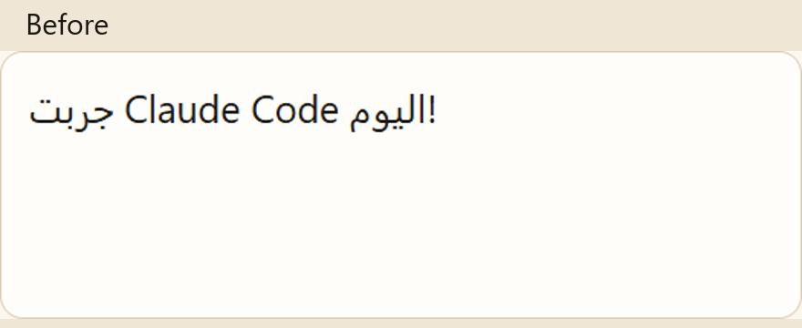
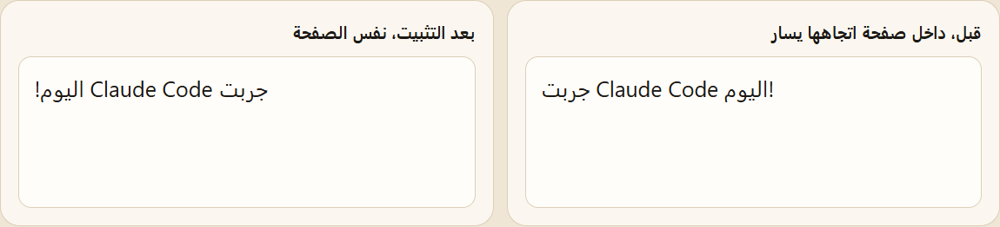

# سطر





يثبّت ترتيب السطر العربي المخلوط بكلمات إنجليزية قبل النشر على X وGitHub وباقي الصفحات التي اتجاهها من اليسار.

سطر مثل «جربت Claude Code اليوم!» تنقلب كلماته وتذهب علامة التعجب إلى بداية السطر. سطر يغلّف الكلمة الإنجليزية بعازل اتجاه، ويثبّت الفقرة لليمين، من غير عكس الحروف ومن غير علامة القلب الإجباري. الأرقام العربية مثل ١٢٠ تبقى في مكانها، والاسم الذي فيه حرف مثل é يبقى كلمة واحدة، والإيموجي في أول السطر لا يقلب الجملة.

الصفحة العامة: <https://khrawaa27-hash.github.io/satr/>

## English

Satr fixes a mixed Arabic and English line before you post it. On X, GitHub, and other left-to-right pages, «جربت Claude Code اليوم!» swaps its words and the exclamation mark jumps to the start. Paste the line and copy the result, or install the Chrome extension. It does not reverse letters. Names like José stay one word, Arabic-Indic digits stay in order, and an emoji at the start of the line does not flip the sentence.

Public page: <https://khrawaa27-hash.github.io/satr/>

## التشغيل

```bash
npm install
npm test
npm start
```

ثم افتح `http://localhost:4173`.

الصق المنشور، قارن الصندوقين، ثم انسخ النص الجاهز. العلامات المخفية تثبت ترتيب الكلمات على X وGitHub ومنصات التواصل وكافة المواقع الأخرى. محاذاة الفقرة إلى اليمين تبقى قرار الموقع نفسه.

## إضافة كروم

استخدم مجلد [`extension`](https://github.com/khrawaa27-hash/satr/tree/master/extension) من المستودع.

1. افتح `chrome://extensions`.
2. فعّل وضع المطوّر.
3. اختر «Load unpacked» ثم المجلد بعد فك الضغط.

الإضافة تضبط اتجاه الفقرات العربية إلى اليمين داخل أي صفحة، وتترك كتل الكود كما هي. من النافذة المنبثقة يمكن إيقافها أو لصق نص قبل النشر. لا تجمع نصاً ولا ترسله: [الخصوصية](https://khrawaa27-hash.github.io/satr/privacy.html).

## تطبيق الهاتف

من هاتفك افتح <https://khrawaa27-hash.github.io/satr/> واختر «إضافة إلى الشاشة الرئيسية». بعد التثبيت، مشاركة أي نص إلى سطر تفتحه جاهزاً للنسخ.

## الرخصة

[MIT](LICENSE)
